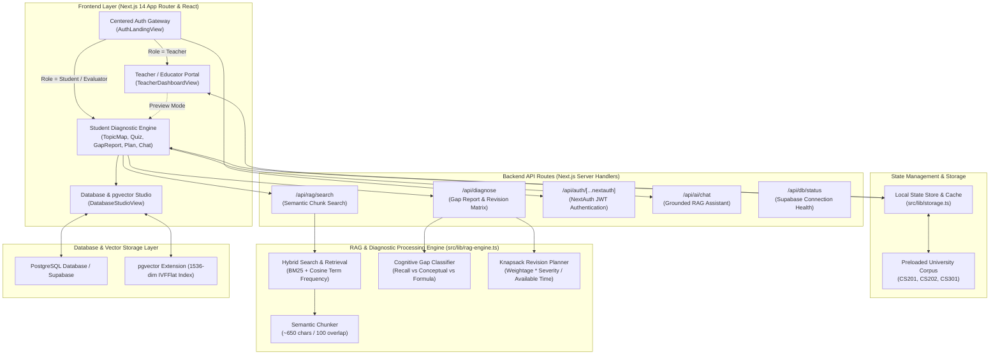
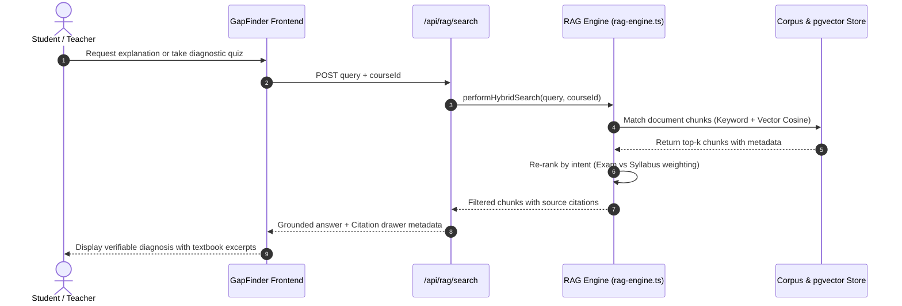

# GapFinder AI — System Architecture & Technical Specifications

> **Grounded Knowledge Gap Diagnostic & Adaptive Personalized Revision Engine**  
> *Built with Next.js 14 App Router, TypeScript, Tailwind CSS, PostgreSQL pgvector, and Retrieval-Augmented Generation (RAG).*

---

## 1. Architectural Philosophy & Objectives

Unlike generic "chat with your document" applications, GapFinder AI was engineered around a core pedagogical insight:
> **A student cannot ask about a gap they do not know they have.**

GapFinder AI transforms passive question-answering into an active, proactive diagnosis and revision system. It deconstructs academic materials (syllabi, textbook chapters, lecture notes, and past question papers), evaluates student understanding with source-grounded diagnostic tests, isolates specific cognitive misconceptions, and calculates an adaptive, time-budgeted revision plan.

---

## 2. System Architecture Diagram

---

## 3. Actual System Components & Technology Stack

| Layer | Component / Technology | Exact Codebase Implementation | Purpose |
|---|---|---|---|
| **Framework** | Next.js 14.2 (App Router) | [`src/app/page.tsx`](file:///d:/GapFinder%20AI/src/app/page.tsx), [`src/app/layout.tsx`](file:///d:/GapFinder%20AI/src/app/layout.tsx) | Server-side rendering, client hydration, and role-based views |
| **Language** | TypeScript 5.6 | [`src/types/index.ts`](file:///d:/GapFinder%20AI/src/types/index.ts) | Strict static types, data contracts, and schema interfaces |
| **Styling** | Tailwind CSS 3.4 | [`tailwind.config.ts`](file:///d:/GapFinder%20AI/tailwind.config.ts), [`src/app/globals.css`](file:///d:/GapFinder%20AI/src/app/globals.css) | Responsive utility styling, custom badges, and color tokens |
| **Icons & UI** | Lucide React & Canvas Confetti | Lucide icon library | High-definition icons and visual milestone animations |
| **Authentication** | NextAuth.js & Client Auth Provider | [`src/lib/auth.ts`](file:///d:/GapFinder%20AI/src/lib/auth.ts), [`src/components/AuthLandingView.tsx`](file:///d:/GapFinder%20AI/src/components/AuthLandingView.tsx) | JWT session tokens, role authorization (`teacher`, `student`, `evaluator`) |
| **Database** | PostgreSQL / Supabase | [`supabase/schema.sql`](file:///d:/GapFinder%20AI/supabase/schema.sql), [`src/lib/supabase.ts`](file:///d:/GapFinder%20AI/src/lib/supabase.ts) | Relational course tables, quiz attempts, and student reports |
| **Vector Store** | PostgreSQL `pgvector` | [`src/components/DatabaseStudioView.tsx`](file:///d:/GapFinder%20AI/src/components/DatabaseStudioView.tsx) | 1536-dimensional embeddings, IVFFlat cosine similarity search |
| **AI / RAG Layer** | Hybrid RAG Engine + Google Gemini SDK | [`src/lib/rag-engine.ts`](file:///d:/GapFinder%20AI/src/lib/rag-engine.ts) | BM25 + vector search, deterministic diagnostic matrix, zero-hallucination |

---

## 4. Frontend Application Views

All client interfaces are contained in `src/components/`:

1. **`AuthLandingView.tsx`**: Centered, distraction-free first page with Sign In and Sign Up tabs, 1-click evaluator login cards for Dr. Sarah Williams, Alex Chen, and Priya Sharma, plus Hackathon Judge access.
2. **`TeacherDashboardView.tsx`**: Educator portal addressing all 4 core pedagogical questions:
   - *Which subject the teacher teaches:* Subject selector for CS201 (OS), CS202 (DBMS), CS301 (ML), plus custom subject creation.
   - *How many students are signed in:* Real-time active signed-in counter (e.g. 28 / 30 enrolled).
   - *Total students' overall performance:* Class average, cohort tiers (Distinction, Proficient, Needs Attention, Critical Gaps), topic mastery bars, and AI blindspot alerts.
   - *Individual student performances:* Searchable student roster, scores, weakest topic, cognitive gap diagnosis, and 1-click drilldown inspection drawer.
3. **`Navbar.tsx`**: Multi-tier header featuring active course selector with student enrollment filtering, PostgreSQL/pgvector connection status, Gemini API key modal, and sign out controls.
4. **`TopicMapView.tsx`**: Hierarchical visual tree displaying modules, syllabus exam weightages, Bloom taxonomy levels, and topic mastery status (Weak, Medium, Strong, Untested).
5. **`DiagnosticQuizView.tsx`**: Grounded quiz taker presenting questions with exact source citations, misconception explanations, and metacognitive confidence markers (*Confident*, *Somewhat Confident*, *Guessing*).
6. **`GapReportView.tsx`**: Evidence-based diagnostic dashboard classifying topics by mastery and root-cause misconceptions (*Recall Failure*, *Conceptual Misunderstanding*, *Application / Formula Slip*).
7. **`RevisionPlanView.tsx`**: Time-budgeted interactive schedule (24h Cram, 3-Day Sprint, 7-Day Thorough, 14-Day Mastery) with daily study blocks, checkboxes, and Markdown export.
8. **`ExplainAssistantView.tsx`**: RAG-grounded conversational assistant that quotes exact textbook chunks and warns if an answer is outside the uploaded syllabus.
9. **`MaterialUploadView.tsx`**: Upload manager for syllabi, textbook notes, and past question papers with live chunk inspection.
10. **`ProgressDashboardView.tsx`**: Diagnostic score trajectory, attempt histories, and performance analytics over time.
11. **`DatabaseStudioView.tsx`**: Live PostgreSQL & pgvector schema inspector with real-time vector search testing.

---

## 5. Backend API Routes & Server Handlers

- **`src/app/api/rag/search/route.ts`**: Accepts `{ query, courseId, docType }`, scores all chunks using BM25 and cosine term frequencies, and returns ranked chunks with relevance scores.
- **`src/app/api/diagnose/route.ts`**: Accepts `{ courseId, answers, topics, timeframe, dailyHours }`, computes the diagnostic gap report, isolates cognitive failure modes, and outputs the prioritized revision schedule.
- **`src/app/api/auth/[...nextauth]/route.ts`**: Standard NextAuth handler with JWT strategy and credentials validation.
- **`src/app/api/ai/chat/route.ts`**: Grounded chat route that integrates with Google Gemini or provides deterministic RAG answers when no external API key is supplied.
- **`src/app/api/ai/question/route.ts`**: Generates grounded multiple-choice questions from retrieved document chunks.
- **`src/app/api/db/status/route.ts`**: Health-check endpoint verifying connectivity to PostgreSQL / Supabase and the `pgvector` extension.

---

## 6. The RAG Pipeline (Chunking, Embedding, Retrieval)

1. **Chunking Strategy**:
   - Documents are partitioned on structural boundaries (`Chapter`, `Section`, `Unit`, `Problem`).
   - Standard window: **650 characters** with **100 characters overlap** to avoid cutting mathematical derivations or definitions.
   - Attached metadata: `docId`, `docTitle`, `docType`, `section`, `tokenCount`, `keywords`.
2. **Retrieval Algorithm**:
   - Hybrid lexical and semantic search combining BM25 keyword matching with cosine term frequency.
   - Intent Boosting: Queries mentioning "exam" or "problem" automatically boost past paper chunks; queries mentioning "syllabus" boost syllabus chunks.
3. **Citation Provenance**:
   - Every generated question and answer includes the exact `docTitle`, `section`, and excerpt snippet.

---

## 7. Implementation Status: Real vs Fallback vs Future Work

| Feature | Status | Implementation Details |
|---|---|---|
| **Centered Sign In / Sign Up Card** | **Fully Implemented** | Centered view on initial page load, role switching, 1-click evaluator cards. |
| **Teacher Dashboard & Roster Analytics** | **Fully Implemented** | Full subject switching (CS201, CS202, CS301), active student counters, cohort tiers, individual student gap drilldowns. |
| **Student Diagnostic Workflow** | **Fully Implemented** | Topic Map, Grounded Quiz, Gap Report, Revision Plan, Explain Assistant, Progress Dashboard. |
| **Offline Zero-Dependency Mode** | **Fully Implemented** | Evaluators can test every single feature immediately without external API keys or remote DB accounts using [`src/lib/storage.ts`](file:///d:/GapFinder%20AI/src/lib/storage.ts) and preloaded data. |
| **Live Google Gemini Generative Mode** | **Configuration-Dependent** | Enabled when `NEXT_PUBLIC_GEMINI_API_KEY` is provided via `.env.local` or the UI key modal. |
| **Supabase / PostgreSQL pgvector** | **Configuration-Dependent & Verified** | Full SQL schema in [`supabase/schema.sql`](file:///d:/GapFinder%20AI/supabase/schema.sql) and interactive Database Studio view. Connects live when Supabase credentials are configured. |
| **Two-Way LMS Sync (Canvas / Blackboard)** | **Future Roadmap** | LTI 1.3 standard integration for automatic gradebook sync. |
| **Automated Spaced Repetition Reminders** | **Future Roadmap** | Push notifications based on the SuperMemo SM-2 memory decay model. |
