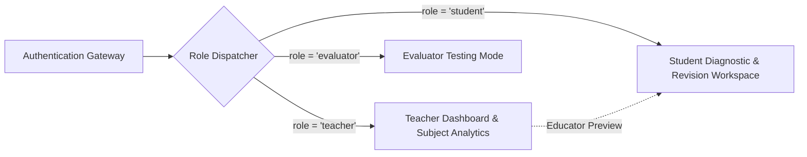

# GapFinder AI — Security & Privacy Policy

This document details the security posture, secrets management policies, authentication controls, and data privacy safeguards implemented in **GapFinder AI**.

---

## 1. Secrets Management & Environment Isolation

### Zero-Secret Commit Invariant
- **Rule**: No private API keys, cryptographic tokens, database connection strings, or service-role passwords are ever committed to this repository.
- **Enforcement**:
  - The repository's [`.gitignore`](file:///d:/GapFinder%20AI/.gitignore) explicitly excludes all `.env`, `.env*.local`, `.env.development.local`, `.env.test.local`, `.env.production.local`, and cryptographic certificate files (`*.pem`, `*.key`).
  - [`.env.example`](file:///d:/GapFinder%20AI/.env.example) contains only non-sensitive variable names with safe placeholder tokens (e.g., `AIzaSy...`, `your-anon-public-key`).

### Supabase Service-Role Key Handling
- The `SUPABASE_SERVICE_ROLE_KEY` possesses administrative bypass privileges over Row Level Security (RLS).
- **Invariant**: The service-role key is **strictly prohibited** from client-side bundles and frontend components. It may only be utilized in isolated server-side API routes if administrative database seeding is required.

---

## 2. Authentication & Role-Based Access Control (RBAC)

GapFinder AI implements role-based authorization to cleanly decouple teacher functions from student workflows:

### Authorization Roles
1. **Teacher / Educator (`role: 'teacher'`)**:
   - Authorized to view class-level aggregated scores, distribution tiers, systemic curriculum blindspots, and individual student diagnostic reports.
   - Authorized to add subjects, view enrolled student rosters, and dispatch remedial nudges.
2. **Student (`role: 'student'`)**:
   - Authorized to take diagnostic quizzes, view personal gap reports, and follow customized revision plans.
   - Restrained to viewing only their enrolled courses (e.g., Alex Chen only sees CS201 and CS202; Priya Sharma only sees CS201 and CS301).
3. **Evaluator / Judge (`role: 'evaluator'`)**:
   - Granted administrative evaluation access across all course subjects and testing views.

---

## 3. Public Demo Credentials & Synthetic Data Policy

> [!WARNING]
> **DEMO CREDENTIALS WARNING**: The demo accounts documented in this repository (`prof.sarah@gapfinder.demo`, `alex.chen@gapfinder.demo`, `priya.sharma@gapfinder.demo`) are provided **strictly for demonstration and project evaluation**.

1. **Synthetic Demonstration Data Only**: All preloaded courses, quiz scores, diagnostic reports, and student records are 100% synthetic mock datasets created for academic demonstration. No real personal identifiable information (PII) is stored.
2. **Do Not Store Private Information**: Evaluators and users must **never enter real passwords, confidential academic exams, or personal identity information** into these demo accounts.
3. **Password Security**: The passwords documented in the README (`Professor@123`, `Student@123`) must never be used for real external services.

---

## 4. Privacy & RAG Zero-Hallucination Guardrails

### Source Attribution
- The RAG retrieval pipeline isolates answers to the uploaded academic corpus.
- If a user asks a question about an unverified topic, the Explain Assistant returns an explicit boundary warning:
  > *"I could not find exact passages in your uploaded syllabus or notes. To maintain strict RAG grounding, please upload relevant material."*
- Every diagnostic question is traceable to a specific textbook chunk and section header to eliminate hallucinated assertions.

---

## 5. Security Vulnerability Reporting

If you discover a security vulnerability in GapFinder AI, please report it privately:

- **Email**: `security@gapfinder.ai` or submit a private security advisory on GitHub.
- Please include reproduction steps, affected routes, and potential impact.
- Do not disclose vulnerabilities in public GitHub issues until a fix has been deployed.
